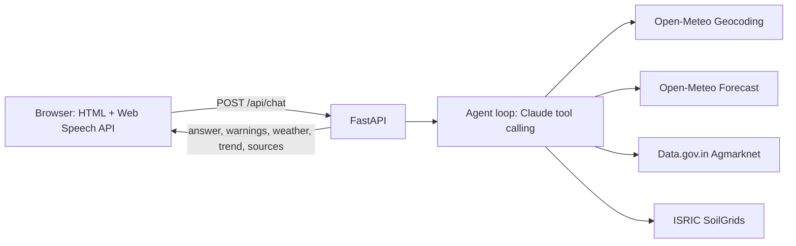

# Kisan Saathi – Farmer Advice Assistant (Hindi + English)

Voice/text assistant: live 7-day weather + live mandi prices + soil → plain-language farm advice with sources and timestamps. **No dummy data**: every number comes from a live API call at request time.

## Architecture

Guardrail: if the model answers without calling any tool, it is sent back once to use tools; otherwise a polite "farming questions only" message is returned. Weather warnings and the 7-day strip are computed from live forecast data in code, not by the LLM.

## Setup
```bash
cd kisan-saathi
python -m venv .venv && source .venv/bin/activate
pip install -r requirements.txt
cp .env.example .env   # fill in keys
```
- `ANTHROPIC_API_KEY`: console.anthropic.com
- `DATA_GOV_IN_API_KEY`: free at data.gov.in (register → My Account). Confirm the resource ID for "Current daily price of various commodities from various markets (Mandi)" and set `MANDI_RESOURCE_ID` if it differs.

## Run
```bash
uvicorn backend.main:app --reload --app-dir .
# open http://localhost:8000
```
(If the import fails, use: `cd backend && uvicorn main:app --reload`.)

## Endpoints
`POST /api/chat`, `GET /api/weather?place=`, `GET /api/prices?state=&commodity=&district=`, `GET /api/health`.

## Tests (real network calls)
```bash
pytest -v
```
Manual acceptance checks: Hindi + Kanpur + Wheat + "Is this week good for irrigation?"; potato selling question; nonsense place; change location and watch values change; block network to see clear errors.

## Known limitations
- Not yet verified end-to-end in the build sandbox (no network there); run the tests with your keys first.
- Agmarknet often returns only recent dates, so the 7-day trend may have fewer points; the app says so rather than inventing data. The trend is the average modal price across markets returned, not one mandi.
- Web Speech API works best in Chrome/Edge/Android; Safari/Firefox support varies. Typing always works.
- SoilGrids can be slow/unavailable; soil is optional and skipped with a message.
- IMD data and growth-stage-specific rules are not implemented. Chat history lives only in the browser tab; nothing is stored server-side.
- Deployment (HF Spaces/Render) not configured; add `uvicorn` start command and env secrets there.

## Troubleshooting
- 500 "ANTHROPIC_API_KEY is not set": check `.env`.
- "Mandi price API key is not configured": set `DATA_GOV_IN_API_KEY`.
- No prices: district/commodity spelling must match Agmarknet (e.g. "Kanpur Nagar"); the app falls back to state level.
